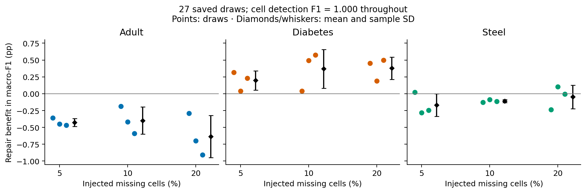

# Dataset Quality and AI Readiness

[](https://www.python.org/downloads/)
[](LICENSE)

Research companion for **Evaluating Dataset Quality and Machine Learning Readiness with Tool-Grounded Agents** by **Muzakkiruddin Ahmed Mohammed, John Talburt, and Abdelrahman Elfikky**, University of Arkansas at Little Rock.

[Read the manuscript](paper/manuscript.pdf) · [Reproduction guide](docs/REPRODUCIBILITY.md) · [Dataset sources](docs/DATA.md) · [Preservation and scope](docs/PROVENANCE.md)

## Overview

The study connects four distinct questions: whether a defect is detected, whether a permitted repair preserves protected values, whether the repair improves held-out predictive performance, and whether the resulting table meets a reference-relative readiness contract.

The framework uses deterministic inspection and repair tools, with rules, a single tool-using language model, and a specialist team as alternative assessors. Experiments use the Adult, Diabetes, and Steel classification tasks. The public toolkit exposes the deterministic components and saved evidence used to study these questions.

## What the evidence shows

- In 27 Logistic Regression missingness comparisons, cell detection F1 is 1.000 throughout, while mean repair effects differ: **−0.485 pp** for Adult, **+0.315 pp** for Diabetes, and **−0.108 pp** for Steel.
- In the six-case readiness study, rules and the single model each make **4/6** correct decisions; the team makes **3/6**. The single model completes **5/6** assignments and the team completes **3/6**.
- Execution failures remain in the assignment denominators. Completed-only accuracy does not establish architectural superiority.

These are the manuscript's bounded, descriptive findings. Reused holdouts, small cohorts, differing historical repair policies, and the lack of an untouched external cohort limit generalization. Readiness here is relative to a declared task and reference, not deployment certification.



*A redraw of the saved measurements: individual draws and mean ± sample SD. The plotted values are unchanged.*

## Quick start: reproduce saved summaries

Python **3.12** is the reference version. The numerical replay uses only the Python standard library and makes no network requests.

```bash
git clone https://github.com/MohdMuzakkiruddinAhmed/dataset-quality-ai-readiness.git
cd dataset-quality-ai-readiness
python scripts/verify_package.py
python scripts/reproduce.py
```

Outputs are written to `outputs/reproduction/summary.json` and `outputs/reproduction/tables.md`. This recreates the numerical summaries in Tables II–V from saved measurements. The included [table preview](results/tables.md) makes the results browsable on GitHub.

## Install the research toolkit

Create an environment from the repository root:

```bash
python -m venv .venv
```

Activate it with `.venv\Scripts\Activate.ps1` in PowerShell or `source .venv/bin/activate` on macOS/Linux, then install:

```bash
python -m pip install -r requirements.txt
python -m pip install -e ".[dev,figures]"
```

The scientific dependencies retain the original pinned versions. Optional plotting and test dependencies are declared in `pyproject.toml`.

```bash
python examples/offline_readiness.py
python scripts/plot_results.py
python -m pytest
```

The example uses an explicitly synthetic table to demonstrate corruption, observation-only rules, constrained repair, and protected-value verification. Its output is not a new research result. Plotting redraws the saved missingness and native-control measurements and the six-case outcome matrix.

## Repository map

| Path | Purpose |
|---|---|
| `paper/manuscript.pdf` | Unchanged author-supplied manuscript |
| `src/dataset_readiness/` | Original deterministic dataset, profiling, corruption, repair, evaluation, and ML components |
| `evidence/` | Selected saved scientific measurements, source hashes, and attempt outcomes |
| `configs/` | Readiness policy and recorded assessor protocol |
| `protocols/prompts/` | Original agent prompts for methodological inspection |
| `scripts/` | Offline verification, numerical replay, and plotting |
| `examples/` | Small runnable demonstration without external data |
| `tests/` | Original component tests and publication-package checks |
| `results/` | Reproduced table preview and figures |
| `docs/` | Reproduction boundaries, data attribution, and provenance |

## Reproduction scope

This is a compact **offline research package**. It preserves saved agent outcomes and prompts; it does not execute live-provider assessments. Dataset download functions remain available for deliberate acquisition from the original sources.

Numerical replay is distinct from refitting the original experiments. The package does not include the complete historical archive, row-level datasets, all held-out predictions, fitted models, or the full experiment orchestration. It therefore does not claim to reproduce every original fit or bootstrap interval. See [the reproduction guide](docs/REPRODUCIBILITY.md).

No research thresholds, seeds, recorded scores, repair rules, or scientific conclusions were changed for this release. Two modules omit unused orchestration helpers; retained scientific definitions are preserved. [Provenance](docs/PROVENANCE.md) describes those packaging adaptations.

## Citation

Please cite the manuscript and identify the repository commit used. No confirmed publication venue, acceptance status, or DOI was supplied; the citation intentionally uses manuscript status.

```bibtex
@misc{mohammed2026datasetreadiness,
  author = {Mohammed, Muzakkiruddin Ahmed and Talburt, John and Elfikky, Abdelrahman},
  title = {Evaluating Dataset Quality and Machine Learning Readiness with Tool-Grounded Agents},
  year = {2026},
  note = {Author-supplied manuscript; accompanying research software and evidence},
  url = {https://github.com/MohdMuzakkiruddinAhmed/dataset-quality-ai-readiness}
}
```

Machine-readable software citation is provided in [CITATION.cff](CITATION.cff). Cite the underlying datasets separately when using them.

## License

The project is released under the [MIT License](LICENSE). The upstream UCI datasets retain their own [attribution requirements](docs/DATA.md).
